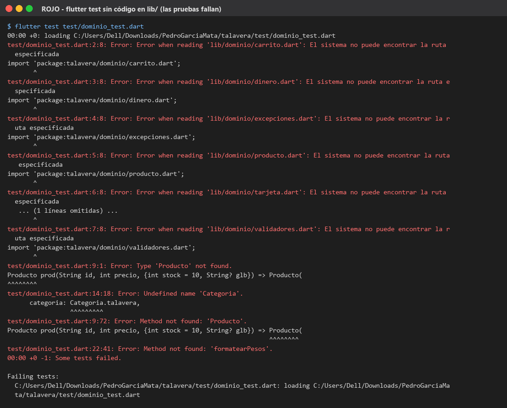
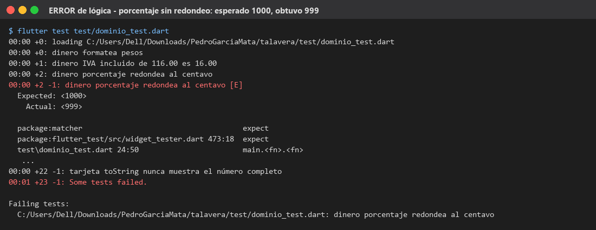
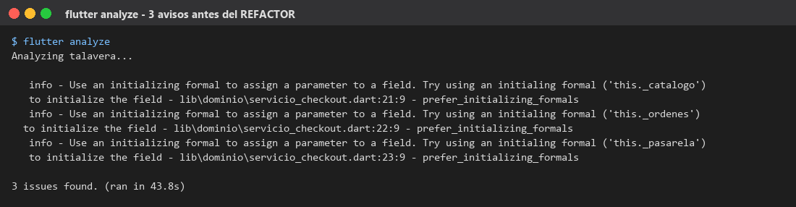
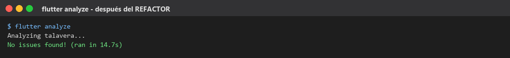
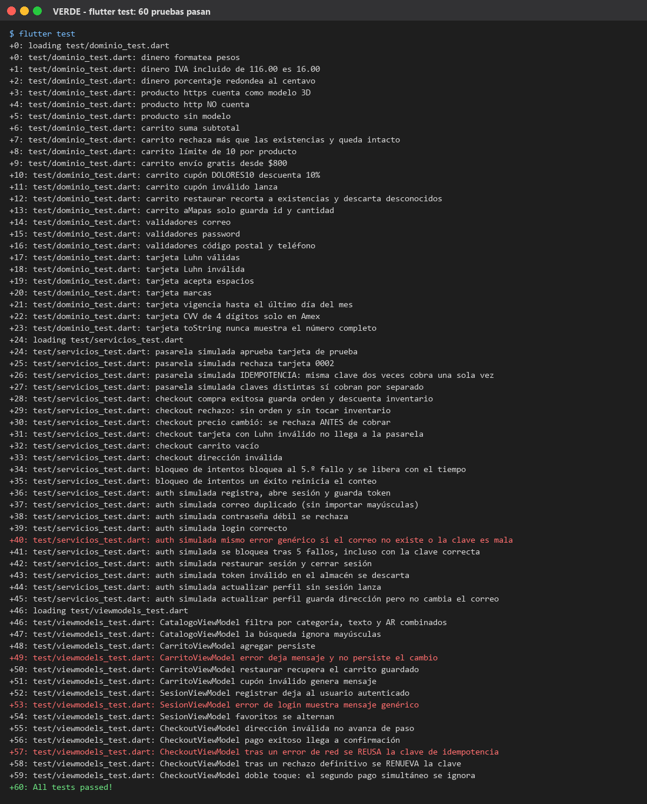
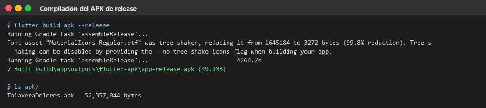

# Talavera Dolores — tienda móvil con TDD

App Flutter de comercio electrónico para artesanías de Dolores Hidalgo, construida paso a paso con
**TDD (Rojo → Verde → Refactor)** siguiendo el *Manual paso a paso con TDD* de Desarrollo Móvil
Integral · UTNG (Prof. Anastacio Rodríguez García).

**Funciones:** catálogo con filtros · carrito persistente con cupones y envío gratis · checkout en 3
pasos con pasarela de pagos **simulada** · cuentas de usuario con perfil, favoritos y "Mis compras" ·
**"Ver en tu espacio"** con realidad aumentada (`model_viewer_plus`).

> ⚠️ La pasarela de pagos y el servidor de cuentas son **simulados**. La app nunca procesa dinero real.

---

## 📦 APK

| Archivo | Ruta |
|---|---|
| APK de release | `build/app/outputs/flutter-apk/app-release.apk` |
| Copia lista para entregar | `apk/TalaveraDolores.apk` (49.9 MB) |

Para generarlo de nuevo:

```bash
flutter build apk --release
```

**Instalar:** copia el `.apk` al teléfono, ábrelo y acepta "instalar apps de origen desconocido".
"Ver en tu espacio" requiere internet (el modelo 3D se descarga por https) y, para la AR, un teléfono
compatible con ARCore y la app *Google Play Services for AR*.

---

## 🏗️ Arquitectura en capas

```
lib/
├── dominio/        ← reglas del negocio (Dart puro, sin Flutter)
│   dinero · producto · carrito · validadores · direccion · tarjeta
│   usuario · orden · excepciones · contratos · servicio_checkout · bloqueo_intentos
├── datos/          ← implementaciones: memoria, shared_preferences, secure storage
│   catalogo_memoria · almacenes · pasarela_simulada · auth_simulada
├── presentacion/
│   ├── vm/         ← catalogo_vm · carrito_vm · sesion_vm · checkout_vm (ChangeNotifier)
│   └── pantallas/  ← catálogo, detalle, ver_en_tu_espacio, carrito, checkout, perfil
├── dependencias.dart  ← raíz de composición (único lugar donde se eligen implementaciones)
└── main.dart
test/
├── dominio_test.dart      (24 pruebas)
├── servicios_test.dart    (22 pruebas)
└── viewmodels_test.dart   (14 pruebas)
```

Las dependencias apuntan siempre hacia el **dominio**: por eso toda la lógica se prueba en segundos,
sin emulador.

---

## 🔴🟢🔵 Evidencia del ciclo TDD

### 1. 🔴 ROJO — las pruebas se escriben primero y fallan

Se escribieron las 60 pruebas de `test/` **antes** que el código. Al correr `flutter test`, falla
porque `lib/dominio/...` todavía no existe:



### 2. ❌ Error de lógica atrapado por una prueba

Primero se programó `porcentaje()` de la forma "ingenua", sin redondear:

```dart
int porcentaje(int centavos, int pct) => (centavos * pct) ~/ 100;   // ❌ trunca
```

La prueba de borde `porcentaje(9999, 10)` esperaba **1000** centavos y obtuvo **999**: se perdía un
centavo. Este es el caso que el manual pide vigilar:



**Corrección** (se suma la mitad del divisor antes de dividir, solo con enteros):

```dart
int porcentaje(int centavos, int pct) => (centavos * pct + 50) ~/ 100;  // ✅ redondea
```

### 3. 🔵 REFACTOR — limpiar sin romper nada

`flutter analyze` señaló 3 avisos de estilo en `ServicioCheckout` (campos que se podían inicializar
directo en el constructor):



Se refactorizó el constructor a `required this._catalogo, ...` y se volvió a correr todo:



### 4. 🟢 VERDE — las 60 pruebas pasan



### 5. 📦 Compilación del APK



> La primera compilación tardó ~71 min en un equipo con 8 GB de RAM: el paso de R8 (reducción de
> código Java) se quedó sin memoria libre y Windows tuvo que usar el disco. Las siguientes
> compilaciones reutilizan la caché de Gradle y son mucho más rápidas.

---

## ✅ Qué cubren las pruebas

| Grupo | Ejemplos de lo que se verifica |
|---|---|
| Dinero | formato `$1,250.00`, IVA incluido 16 %, redondeo al centavo |
| Producto | solo se acepta modelo 3D por `https://` o `assets/` (nunca `http://`) |
| Carrito | máximo 10 por producto, no excede existencias y **queda intacto** si falla, envío gratis desde $800, cupones `DOLORES10`/`TALAVERA15`, restaurar sin confiar en datos guardados |
| Validadores | correo, contraseña (8+ con letras y números), C.P. de 5 dígitos, teléfono de 10 |
| Tarjeta | algoritmo de Luhn, marcas Visa/Mastercard/Amex, vigencia, CVV, `toString` nunca muestra el número completo |
| Pasarela | aprobada / rechazada, **idempotencia** (misma clave no cobra dos veces) |
| Checkout | revalida precio y existencias **antes** de cobrar; si se rechaza no crea orden ni toca inventario |
| Cuentas | sal + hash, error genérico de login, bloqueo tras 5 intentos, token en almacenamiento seguro |
| ViewModels | filtros combinados, persistencia del carrito, reuso/renovación de la clave de idempotencia, doble toque ignorado |

Correr las pruebas:

```bash
flutter test
```

---

## 📱 Capturas de la app

> Tomadas en un teléfono físico con el APK instalado.

| Catálogo | Detalle del producto | Ver en tu espacio (3D/AR) |
|---|---|---|
|  |  |  |

| Carrito con cupón | Checkout — dirección | Checkout — pago |
|---|---|---|
|  |  |  |

| Compra confirmada | Perfil y "Mis compras" | Error: tarjeta rechazada |
|---|---|---|
|  |  |  |

| Error: login incorrecto | Error: cuenta bloqueada | Error: existencias insuficientes |
|---|---|---|
|  |  |  |

### Datos para probar en la app

| Caso | Qué escribir | Resultado esperado |
|---|---|---|
| Pago aprobado | `4242 4242 4242 4242`, mes `12`, año `30`, CVV `123` | Confirmación y orden en "Mis compras" |
| Tarjeta rechazada | `4000 0000 0000 0002` | "Pago rechazado… No se hizo ningún cargo." |
| Fondos insuficientes | `4000 0000 0000 9995` | "Pago rechazado: Fondos insuficientes…" |
| Luhn inválido | `4242 4242 4242 4241` | "El número de tarjeta no es válido." |
| Cupón | `DOLORES10` o `talavera15` | 10 % o 15 % de descuento |
| Cupón inválido | `XYZ` | "Ese cupón no es válido." |
| Existencias | Agregar 6 rebozos (solo hay 5) | "Solo quedan 5 de "Rebozo tejido"." |
| Bloqueo | 5 contraseñas mal seguidas | "Demasiados intentos. Intenta de nuevo en 15 minutos." |

---

## 🛠️ Cómo correr el proyecto

```bash
flutter pub get
```

```bash
flutter test
```

```bash
flutter run
```

**Dependencias:** `model_viewer_plus`, `shared_preferences`, `flutter_secure_storage`, `crypto`.
El `AndroidManifest.xml` incluye el permiso `INTERNET` para cargar los modelos 3D.

## 🔐 Dónde se guarda cada dato

| Dato | Dónde | Por qué |
|---|---|---|
| Carrito (id, cantidad) | `shared_preferences` | No es secreto; el precio se relee del catálogo |
| Token de sesión | `flutter_secure_storage` (Keystore) | Es una llave |
| Contraseña | En ningún lado (solo sal + hash en el "servidor") | Nunca se guarda |
| Tarjeta completa / CVV | En ningún lado | PCI DSS |
| Últimos 4 dígitos | En la orden | Referencia segura |
